<picture><source media="(prefers-color-scheme: dark)" srcset="assets/dark/hero.svg"></picture>

<a href="https://linkedin.com/in/larscools"><picture><source media="(prefers-color-scheme: dark)" srcset="assets/dark/l-linkedin.svg"></picture></a>
<a href="https://github.com/larscoo"><picture><source media="(prefers-color-scheme: dark)" srcset="assets/dark/l-github.svg"></picture></a>
<a href="https://www.youtube.com/channel/UCr7wsObK-zBzngwvZ3MlxWw"><picture><source media="(prefers-color-scheme: dark)" srcset="assets/dark/l-youtube.svg"></picture></a>
<a href="https://instagram.com/larscools14"><picture><source media="(prefers-color-scheme: dark)" srcset="assets/dark/l-instagram.svg"></picture></a>

<picture><source media="(prefers-color-scheme: dark)" srcset="assets/dark/s01.svg">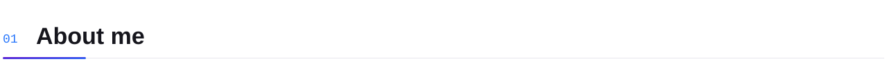</picture>

<picture><source media="(prefers-color-scheme: dark)" srcset="assets/dark/a1.svg">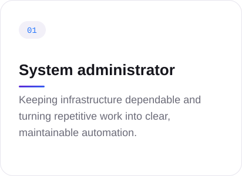</picture>
<picture><source media="(prefers-color-scheme: dark)" srcset="assets/dark/a2.svg">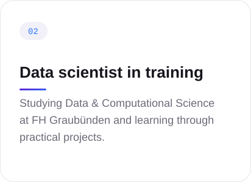</picture>
<picture><source media="(prefers-color-scheme: dark)" srcset="assets/dark/a3.svg">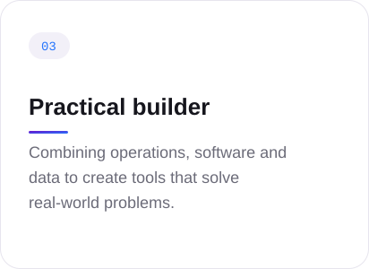</picture>

 

<picture><source media="(prefers-color-scheme: dark)" srcset="assets/dark/s02.svg">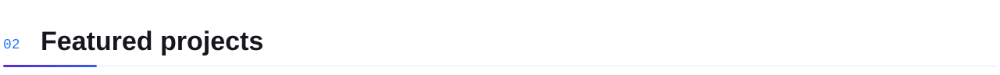</picture>

<a href="https://github.com/larscoo/ShelfOps"><picture><source media="(prefers-color-scheme: dark)" srcset="assets/dark/p1.svg">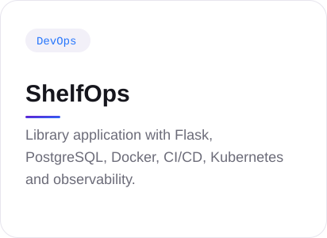</picture></a>
<a href="https://github.com/larscoo/Strava-to-Notion"><picture><source media="(prefers-color-scheme: dark)" srcset="assets/dark/p2.svg">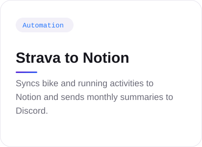</picture></a>
<a href="https://github.com/larscoo/DL-Swisstopo"><picture><source media="(prefers-color-scheme: dark)" srcset="assets/dark/p3.svg">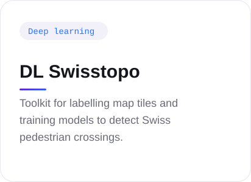</picture></a>

 

<picture><source media="(prefers-color-scheme: dark)" srcset="assets/dark/s03.svg">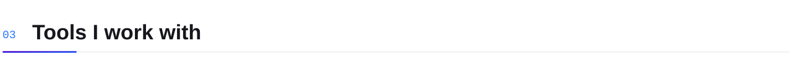</picture>

<picture><source media="(prefers-color-scheme: dark)" srcset="assets/dark/stack.svg">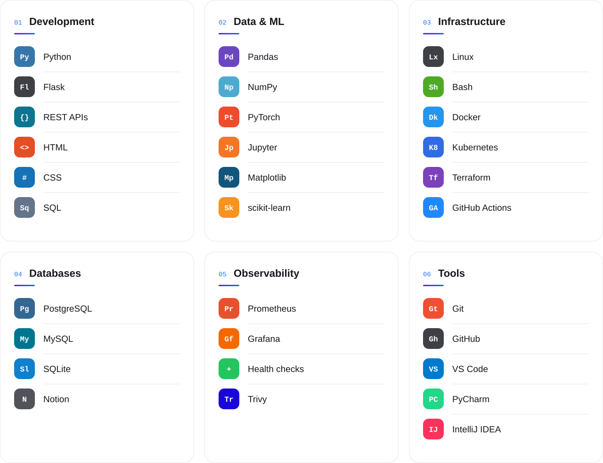</picture>
